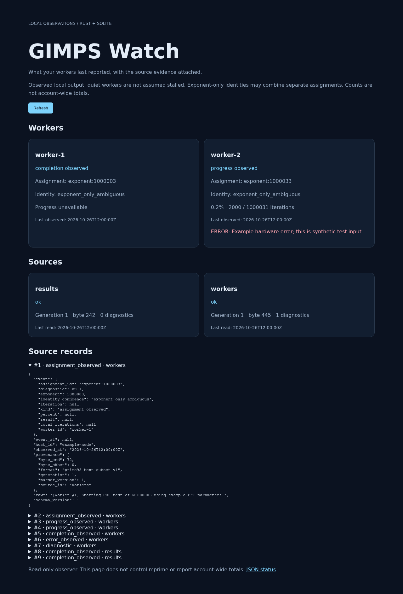

# GIMPS Watch

A small Rust observer for Prime95/mprime output. It tails read-only source files, saves events and checkpoints together in SQLite, and exposes the last observed worker state through a CLI and local dashboard.

**MVP status:** runnable and tested with constructed fixtures. Compatibility with a real mprime installation is **not yet verified**. The included adapters intentionally accept a narrow, documented record subset; they do not claim complete support for any Prime95 release. The author's home-machine logs were unavailable during implementation.



## Run the example

Requirements: Linux, a current stable Rust toolchain, a C compiler for bundled SQLite. Tested with Rust 1.98.1. No system SQLite installation is needed.

```sh
cargo build --release --locked
./target/release/gimps-watch replay --manifest fixtures/basic-run/manifest.json --db /tmp/gimps-demo.sqlite
./target/release/gimps-watch status --db /tmp/gimps-demo.sqlite
./target/release/gimps-watch serve --db /tmp/gimps-demo.sqlite
```

Open <http://127.0.0.1:8787>. The demo shows two workers, one explicit-ID completion result, one ambiguous text completion, and a synthetic error. Two copies of the same JSON result remain in the event history but share one completion key. Repeating `replay` with the same manifest/database ingests zero new records.

Use a new database path to start a separate replay. Replay observation timestamps come from the manifest, so normalized events are reproducible; watch uses the actual observation clock. Source paths are resolved relative to the config or manifest.

## Observe your own output

Copy `gimps-watch.example.toml`, change `host_id`, and point each source at existing captured worker output or a results file. If a file contains one worker without prefixes, set `worker_id = "worker-1"`. Do not point the text adapter at `worktodo.txt`: queue parsing is not implemented.

```sh
./target/release/gimps-watch watch --config gimps-watch.example.toml
# In another terminal:
./target/release/gimps-watch serve --db state.sqlite
./target/release/gimps-watch events --db state.sqlite --limit 50
```

`watch --once` polls once and exits. Ctrl-C stops normally. `serve` reads the database; run `watch` separately to update it. A source's `last_read_at` is an observer attempt timestamp, never evidence that mprime is alive. A configured source ID is bound to its original path and adapter; changing either requires a new source ID or database. One host per database, one active watcher per source.

For a remote machine, run this on your **own computer**:

```sh
ssh -N -L 8787:127.0.0.1:8787 USER@HOST
```

Then open the same localhost URL. The MVP deliberately binds only loopback addresses.

## What the state means

- `assignment_observed`, `progress_observed`, and `completion_observed` describe output the observer saw.
- Progress is null unless explicitly reported. No ETA, inferred liveness, or automatic “stalled” status.
- Errors are retained separately from the last assignment/progress observation.
- An explicit `aid` supports result deduplication. Exponent-only identities can combine separate attempts and are labeled ambiguous.
- These are local records, **not** GIMPS account-wide work totals. The observer never edits queues, starts/stops mprime, submits work, or contacts PrimeNet.

## Read-only API

| Endpoint | Response |
| --- | --- |
| `/healthz` | HTTP process health only |
| `/v1/status` | Worker/source overview and qualified completion counts |
| `/v1/sources` | Checkpoints, observation attempts, source health, diagnostics |
| `/v1/workers` | Last observed worker states |
| `/v1/assignments` | Assignment projections |
| `/v1/events?limit=100&cursor=0` | Events ordered by ID; `next_cursor` when another page exists |

Event limits are 1–500. Projection/source lists are capped at 1,000 entries in this single-host MVP. Events include raw records, source byte ranges, parser version, host, and observation time. Unsupported records are diagnostics. Diagnostic raw text is bounded by the record limit; database history grows with input and is not automatically pruned.

## Reliability and limits

The schema and source checkpoint advance in one `BEGIN IMMEDIATE` transaction with WAL and `synchronous=FULL`. A competing observer with an old checkpoint is rejected. The follower handles LF/CRLF, partial records, restart, inode replacement, truncation, and changed bytes before the checkpoint. Oversized records hold the checkpoint and report source health instead of allocating without a bound or silently discarding data.

On rotation, the old open inode is drained before switching. An unterminated old tail is retained as a diagnostic. Writes to the old inode **after switching**, rotations while the observer is down, or a truncate-and-regrow that reproduces the last 128 committed bytes can be missed. Polling is not an audit-grade lossless log transport. Prefer rename-based rotation and keep archived logs for replay. Files must be regular local log files; pipes and devices are outside the supported configuration.

SQLite history remains local and may contain source paths and raw log content. Back up the database with SQLite's backup facilities while running, or stop both commands before copying the DB/WAL files.

## Validate and develop

```sh
cargo test --locked
cargo fmt --check
cargo clippy --locked --all-targets -- -D warnings
python3 scripts/measure.py    # release build first; synthetic Linux workload
```

See [validation evidence](docs/validation.md), [supported formats](docs/supported-formats.md), and [fixture provenance](fixtures/README.md). `scripts/browser-check.mjs` tests the running dashboard with Playwright.

The MVP is one Cargo package with separate `parser`, `config`, `reader`, `storage`, and `api` modules. This preserves the proposed boundaries without publishing internal workspace crates prematurely. Next acceptance gate: capture actual home-machine output, record its client version/configuration, add anonymized fixtures, and validate a sidecar-only restart during a real run.

MIT licensed. Unaffiliated with the GIMPS project.
